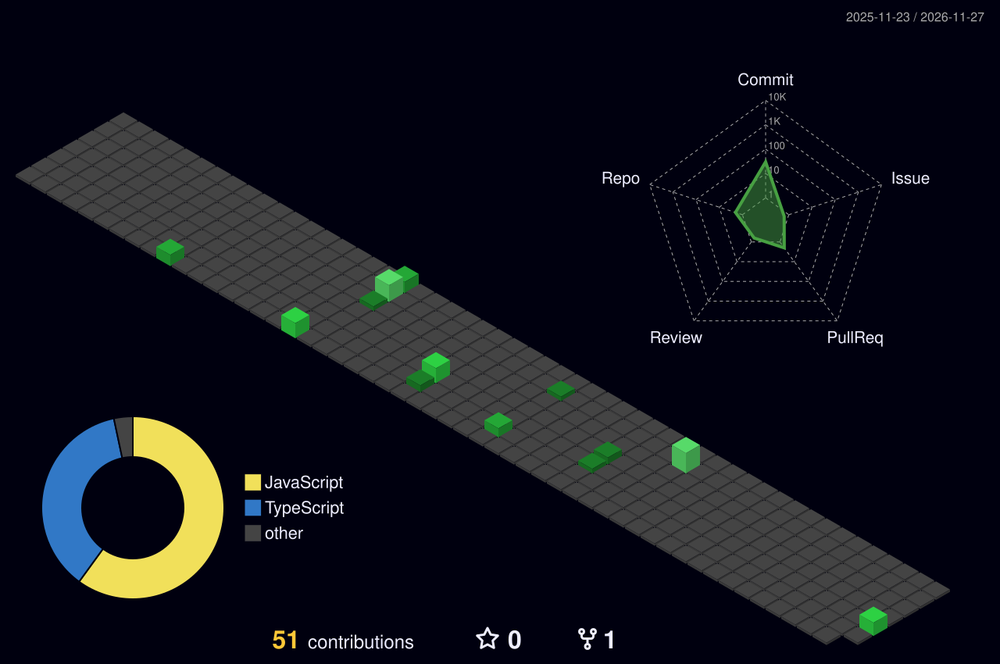

  

  
  
  

 

### `01` &nbsp;About

I am a full-stack software engineer based in Islamabad, Pakistan, with 3+ years of professional
experience building web and cross-platform mobile applications across FinTech, healthcare, tourism,
e-commerce and SaaS. Most of my work sits where product requirements meet system structure: how an
application is divided into modules, what is shared between teams, and how the parts communicate.

- **Now:** MEAN Stack Developer at CyberSoft Vantage, working directly with Sukna Capital, a Saudi
  FinTech company, and leading frontend development of its lending and investment platform: four
  Angular portals built on one private component library.
- **Before:** MERN Stack Developer at Syslab Technologies Sdn Bhd, and Full Stack Developer at SoftoSol.
- **Learning:** ASP.NET Web API and NestJS.

 

### `02` &nbsp;Stack

  
    
  

| Layer | What I use |
| --- | --- |
| Interfaces | Angular, React, Ionic, TypeScript, Tailwind CSS, reusable component libraries and design systems |
| Services | Node.js, Express.js, REST APIs, JWT authentication, role-based access control, SignalR, Socket.IO |
| Infrastructure | MongoDB, PostgreSQL, MySQL, Redis, RabbitMQ, Azure Artifacts, Vercel, Netlify |

 

### `03` &nbsp;Contributions in 3D

  <picture>
    <source media="(prefers-color-scheme: dark)" srcset="./profile-3d-contrib/profile-night-green.svg" />
    <source media="(prefers-color-scheme: light)" srcset="./profile-3d-contrib/profile-green-animate.svg" />
    
  </picture>

 

### `04` &nbsp;Selected work

Case studies, with architecture diagrams, are on my [portfolio](https://omais-ahmed.netlify.app/#projects).
Most of that work is private, so these are the repositories you can read:

| Repository | What it is |
| --- | --- |
| [Omais-Ahmed](https://github.com/omais-ahmad/Omais-Ahmed) | This portfolio: React, TypeScript and Vite, prerendered, with a 3D hero scene and an admin dashboard on Supabase |
| [cr-assessment-frontend-20260721](https://github.com/omais-ahmad/cr-assessment-frontend-20260721) | Angular approver interface for purchase agreement change requests, with permission-aware actions and Jest component tests |
| [my-angular-app-vercel](https://github.com/omais-ahmad/my-angular-app-vercel) | Recursive Angular reactive form for KYC registration of legal entities |
| [tick-tock-app](https://github.com/omais-ahmad/tick-tock-app) | Timesheet tracking interface in React 19 and Tailwind CSS ([live](https://tick-tock-app.vercel.app)) |
| [Event-Management](https://github.com/omais-ahmad/Event-Management) | React client for an events REST API with JWT sign-in and time zone handling |
| [task_manager](https://github.com/omais-ahmad/task_manager) | Task manager on a small hand-written MVC structure in plain PHP and MySQL |

 

### `05` &nbsp;Get in touch

The quickest way to reach me is the contact form on my [portfolio](https://omais-ahmed.netlify.app/#contact),
or a message on [LinkedIn](https://www.linkedin.com/in/omais-ahmed-184660248/).
